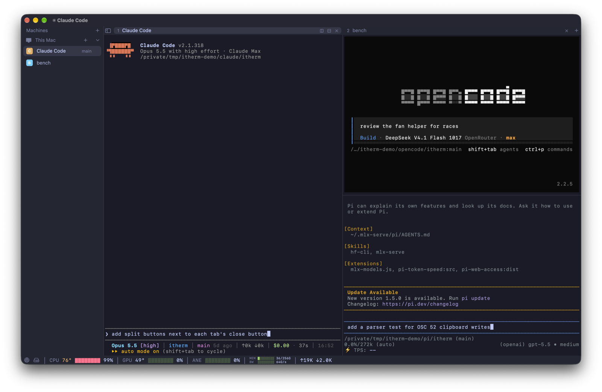
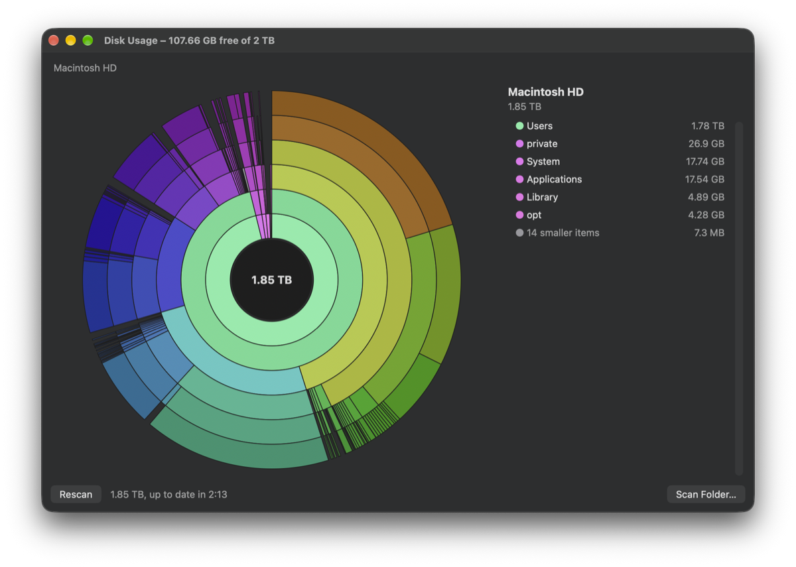
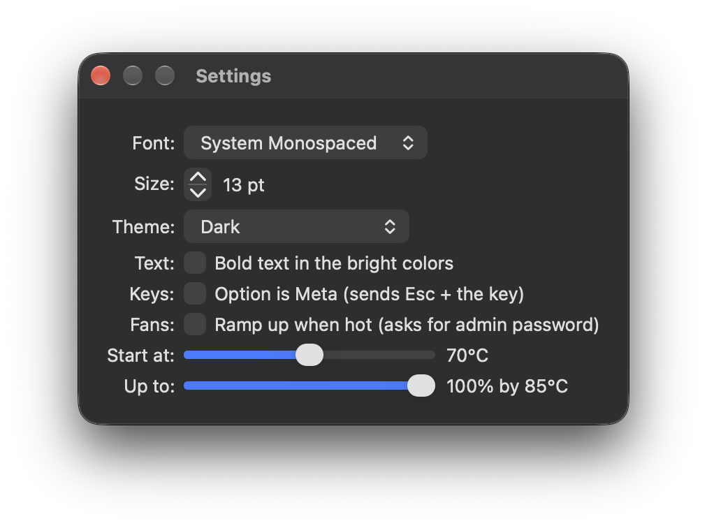
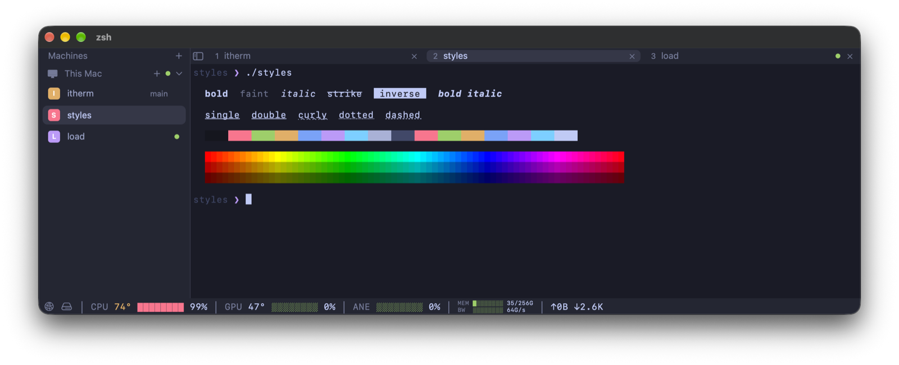

# iTherm

A small terminal for macOS, made for benchmarking. It draws on the CPU and never submits GPU work of its own, so it can't skew a GPU benchmark. A status bar replaces `mactop` and `htop`, and it can run your fans up before the chip throttles.



It started as the terminal I ran inference benchmarks in for [mlx-serve](https://github.com/ddalcu/mlx-serve), and became my default terminal. One Swift file, no dependencies, AppKit and IOKit only.

## Install

```sh
brew tap ddalcu/itherm https://github.com/ddalcu/itherm && brew trust ddalcu/itherm && brew install --cask itherm
```

Or download `iTherm.dmg` from [Releases](https://github.com/ddalcu/itherm/releases). The app is signed and notarized.

Requires an Apple Silicon Mac on macOS 14 or later. It is developed and tested on an M5.

## The status bar

Sampled every 2 seconds off the main thread, so it costs next to nothing.

| Item | Source |
| --- | --- |
| `CPU` temperature, load | hottest SMC CPU sensor (performance and efficiency cores), `host_statistics` |
| `GPU` temperature, load | hottest SMC GPU sensor, IOAccelerator utilization |
| `ANE` load | share of time the Neural Engine was asked to run above idle, from IOReport (the private library behind `powermetrics`; no root needed) |
| `MEM` used/total | Activity Monitor's "Memory Used": app + wired + compressed |
| `BW` | DRAM bandwidth from the memory controllers' IOReport counters, the bar against the chip's rated peak |
| `↑` `↓` | bytes per second over Ethernet and Wi-Fi (not loopback, VPNs or bridges, which would double count) |

Bars go yellow at 60% and red at 85%. Temperatures go yellow once the fans start ramping and red when they reach full speed.

The network icon at the left lists the TCP ports your programs are listening on (web servers, node, ...). Click a port to open `http://localhost:port` in your browser; **Kill** sends the process SIGTERM. Other users' processes need root and aren't shown.

The disk icon beside it opens a chart of what fills the startup disk: the folder you're looking at in the middle, its contents in rings around it, sized by the space they take, with the list largest first beside it. Click a folder to look inside, the middle to go back up, and right-click anything to show it in Finder. The scan is cached, even across relaunches: the window opens on the last one and brings it up to date, as **Rescan** does, by looking again only at the folders macOS's file system log (FSEvents) says changed since. **Scan Folder…** scans another folder or disk from scratch. Folders macOS keeps private (Mail, Messages, other apps' data) are left out unless iTherm has Full Disk Access.



## Fan control

Off by default. Turn it on in **Settings** (⌘,); it asks for your admin password once.



- Below the **start** temperature, macOS runs the fans as usual.
- From there the fan speed ramps linearly up to your **up to** speed, reached 15°C later. At 95°C they run flat out.
- It works from the hotter of the CPU and GPU sensors.

How it works: iTherm launches its own binary as a root helper (`--fan-helper`) that applies the fan speed it reads from a FIFO. When iTherm quits or crashes the FIFO closes, and the helper hands the fans back to macOS. Only one iTherm instance can hold the fan lock (`/tmp/itherm-fan.lock`) at a time.

It writes to the SMC, which Apple doesn't document or support. Use it at your own risk. On older Apple Silicon the code first sets the `Ftst` unlock key; that path is untested because M5 has no such key.

## Machines

The sidebar (the button at the left of the tab bar, or ⌃⌘S, shows or hides it) lists this Mac and the ssh machines you have tabs open on, each with its tabs under it: a letter, the tab's name (what the program titled it, else its folder), the git branch it's on and its dot. Click a tab to show it, a machine's **+** to open another tab there, its chevron to fold its tabs away. New tabs and splits open on the machine you're looking at. Right-click a tab for its menu; right-click an ssh machine to save or forget the connection, or close its tabs.

The **+** beside Machines connects to one:

- **New Connection…** asks for the user, host and port (the host can also be a `Host` from `~/.ssh/config`), and keeps it under **Saved** unless you untick that.
- **Saved** and **Recent** (the last 8 you connected to) are one click away. Hold ⌥ to turn an entry into **Forget**.
- The hosts in `~/.ssh/config` follow.

The tabs of one machine share a single ssh connection (`ControlMaster`), so after the first you don't log in again and a new tab opens at once. If ssh can't connect, or the connection drops, its message stays up until you press Return.

## Knowing which tab needs you

Each tab, and each machine in the sidebar, has a dot:

- **a ring**: printing right now (a build, a benchmark, an agent thinking)
- **green**: it went quiet while you weren't looking: finished, or waiting for input
- **yellow**: it rang the bell or sent a notification (OSC 9 or OSC 777) while you weren't looking

Green and yellow stay until you look at the tab. The Dock icon counts them, and when iTherm is in the background a yellow one also bounces the Dock icon and shows the notification's text. Claude Code and Codex can send these when they finish or need permission: in Claude Code set the notification channel (in `/config`) to the terminal bell or to iTerm2's.

Quitting iTherm saves its windows, tabs, splits and each pane's folder; the next launch reopens them with fresh shells, and ssh tabs reconnect. Closing the last window yourself saves nothing.

## Terminal

- Tabs, split panes, and multiple windows. Drag tabs to reorder; right-click a tab to move it to its own window.
- xterm-256color and truecolor (24-bit, `38;2;r;g;b` and the `38:2::r:g:b` form), the alternate screen, scrollback, bracketed paste, and mouse reporting (including SGR), so vim, htop and tmux work.
- Bold, faint, italic, underline, strike and inverse, and the cursor shapes (DECSCUSR) vim and friends ask for: block, bar or underline. Italics use the font's own italic face, or a slant of the regular one when the family has none.
- Underlines in five styles: single, double, curly, dotted, dashed (`CSI 4:n`), so LSP squiggles arrive as squiggles.
- Full-screen programs hear about the keyboard (1004 focus reporting) and can hold a frame until it is whole (2026 synchronized output), so nvim and zellij redraw in one go instead of in strips.
- OSC 4, 10 and 11 let a program recolor the palette or the background (base16-shell), OSC 52 lets one over ssh set the clipboard.
- 12 themes (Dark, Light, Solarized, Dracula, Nord, Gruvbox, One Dark, Tokyo Night, Catppuccin Mocha, Monokai) and any fixed-pitch font, set in Settings. Two switches there too: bold drawn in the bright colors (Terminal.app's habit), and Option as Meta, which sends `Esc` + the key so `⌥b` and `⌥f` jump words in readline instead of typing ∫ and ƒ.
- Login shell from `$SHELL`, with `TERM=xterm-256color`, `COLORTERM=truecolor` and a UTF-8 `LANG`. New tabs and splits start in the current directory.

Deliberately small: no config file, no ligatures, no image protocols.



| Keys | |
| --- | --- |
| ⌘T / ⌘W | new tab / close tab |
| ⌘1–9, ⌘⇧[ / ⌘⇧] | switch tabs |
| ⌘D / ⌘⇧D | split beside / split below |
| ⌃⌘S | show / hide the machines sidebar |
| ⌘C / ⌘V / ⌘A | copy / paste / select all |
| ⌘, / ⌘Q | settings / quit |

Mouse: drag to select, double-click for a word, triple-click for a line. Click a pane to focus it; the two buttons beside the active tab's × split it below or beside (as ⌘⇧D and ⌘D do), and right-clicking a pane splits it too; drag the divider between two panes to resize them. Programs that ask for the mouse get it; hold ⇧ or ⌥ to select anyway. Drop files on a pane to paste their paths (shell-escaped), or drop text to paste it.

## Why it doesn't use the GPU

Frames are rasterized by CoreGraphics and CoreText into plain memory bitmaps (a `CGContext` over an `IOSurface`, memory shared with the window server, so nothing is copied). Only rows that changed are redrawn, and scrolled output is moved up with a `memmove`. There is no Metal, no OpenGL and no Core Animation drawing. The finished bitmap is handed to macOS as the window's pixels.

macOS still composites the window, as it does for every window, but iTherm adds no GPU load of its own.

## Build

```sh
./bundle.sh                     # build/iTherm.app, ad-hoc signed
cp -R build/iTherm.app /Applications
```

Or just the binary: `swiftc -O itherm.swift -o build/itherm`.

Releases are cut from the **Release** workflow (Actions, Run workflow). It signs with a Developer ID certificate, notarizes, builds the DMG and creates a draft release. Publishing the draft updates the Homebrew cask. The repo needs these secrets: `APPLE_CERTIFICATE_BASE64`, `APPLE_CERTIFICATE_PASSWORD`, `APPLE_ID`, `APPLE_ID_PASSWORD`, `APPLE_TEAM_ID`.

## License

[MIT](LICENSE)
